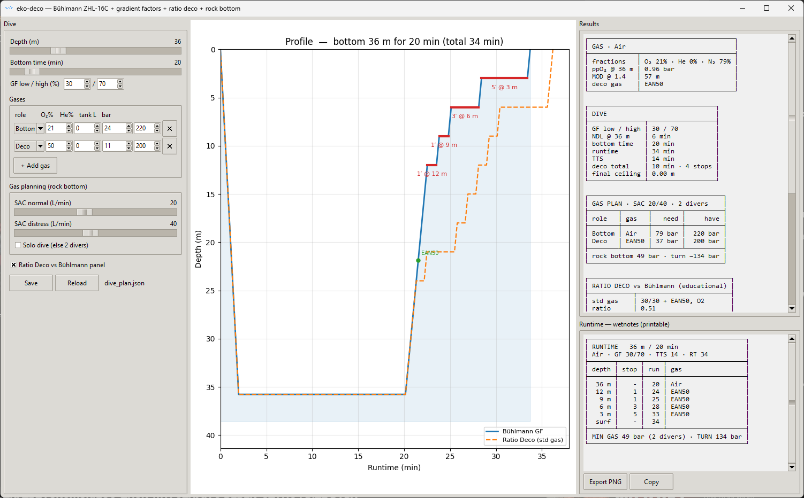

<div align="center">


# eko-deco — Bühlmann ZHL-16C + Gradient Factors

A small Python implementation of the Bühlmann ZHL-16C decompression model with
Erik Baker's gradient factors — a zero-dependency core, plus a CLI and a Tkinter GUI.

**⚠️ Educational only — not validated for planning real dives.**



</div>

> Dive inputs on the left, the depth/time profile with a Ratio-Deco overlay in the
> centre, and framed results + a printable wetnotes runtime on the right.

## What it does

- 16 tissue compartments, N₂ and He, ZHL-16C coefficients.
- Schreiner equation for variable-depth segments (descents/ascents),
  reduces to Haldane at constant depth.
- Erik Baker's gradient-factor formulation:
  `P_amb_tol = (P_comp − a·GF) / (GF/b + 1 − GF)`,
  linearly interpolated between GF-Low at the first stop and GF-High at the
  surface.
- Square-profile planner with automatic first-stop detection, 3 m stops,
  and best-gas selection (deco gases switched at their MOD at ppO₂ ≤ 1.6).
- Multi-gas support: bottom + multiple acceleration/deco gases + travel gases,
  switched automatically by ppO₂ window (MOD ceiling + hypoxia floor). Handles
  hypoxic trimixes (e.g. 10/70) that need a travel gas near the surface.
- Rock-bottom / minimum-gas planning with two SAC values (normal + distress),
  N divers and a problem-solving time, plus Time-To-Surface (TTS).
- Ratio Deco (GUE/UTD) utility with standard gases and a Bühlmann cross-check.
- Shared JSON config (`dive_plan.json`): the GUI and the CLI read/write the same
  dive, so `cli.py plan --save` shows up in the app on Reload and vice-versa.
- Printable **runtime** (wetnotes card) in the GUI — depth / stop / runtime / gas
  plus TTS and minimum-gas / turn pressure — exportable to PNG to take in the water.
- NDL calculator and tissue-loading report.

## The app (GUI)

Run `python app.py` for the visual planner shown above:

- **Left** — every input: depth, bottom time, gradient factors, an editable gas
  stack (bottom / travel / deco, each with its own O₂, He, tank and fill), SAC and
  solo/team, plus **Save / Reload** of the shared `dive_plan.json`.
- **Centre** — the depth-vs-time profile: the Bühlmann GF ascent with stops and
  gas switches, and the Ratio-Deco schedule overlaid for comparison.
- **Right** — results as framed cards (gas, dive summary, per-cylinder gas + rock
  bottom, Ratio-Deco cross-check, stops) and a printable **runtime** wetnotes card,
  exportable to PNG with the `<//> eko-deco` mark.

## Install

Python 3.10+. The core library and CLI need **nothing** beyond the standard
library; the GUI (`app.py`) also needs `matplotlib` (tkinter ships with CPython):

```bash
pip install matplotlib   # GUI only
```

## Command line

```bash
# Recreational
python cli.py plan --depth 30 --time 25 --gas air

# Tech with deco gases
python cli.py plan --depth 45 --time 25 --gas 21/35 \
    --deco-gas 50 --deco-gas 100 --gf-low 0.30 --gf-high 0.70

# Hypoxic trimix + travel gas, per-gas tanks, gas planning (TTS + rock bottom)
python cli.py plan --depth 60 --time 25 --gas 10/70@24 \
    --travel-gas 35/25@11 --deco-gas 50@11 --deco-gas 100@7 \
    --sac 18 --sac-stress 36

# Save a dive to the shared config, then re-plan it (the GUI reads the same file)
python cli.py plan --depth 45 --time 10 --gas air@24 --deco-gas 50@11 --sac 20 --save
python cli.py plan dive_plan.json     # positional config (or --load)

# Ratio Deco with GUE standard gases (+ Bühlmann cross-check)
python cli.py ratio --depth 51 --time 25

# NDL & tissue report
python cli.py ndl     --depth 30 --gas air
python cli.py tissues --depth 40 --time 20 --gas ean32 --json
```

Gas syntax: `air`, `o2`, `ean32` / `nx32` / `32`, trimix `21/35` (fO₂/fHe %).
Add `--json` to any command for machine-readable output.

## Test

```bash
python -m unittest discover -s tests -v
```

Sanity tests cover constant counts, surface saturation, Haldane equivalence,
NDLs against published Bühlmann values (±5 min), gas-switch and travel-gas
behaviour, TTS / rock-bottom gas, and the Ratio Deco schedule.

## References

- A.A. Bühlmann, *Tauchmedizin* (5th ed., 2002) — ZHL-16 coefficients.
- E. C. Baker, *Clearing Up the Confusion About "Deep Stops"* (gradient
  factors).
- E. C. Baker, *Understanding M-values*.
- Subsurface dive-log source (constants cross-check).
