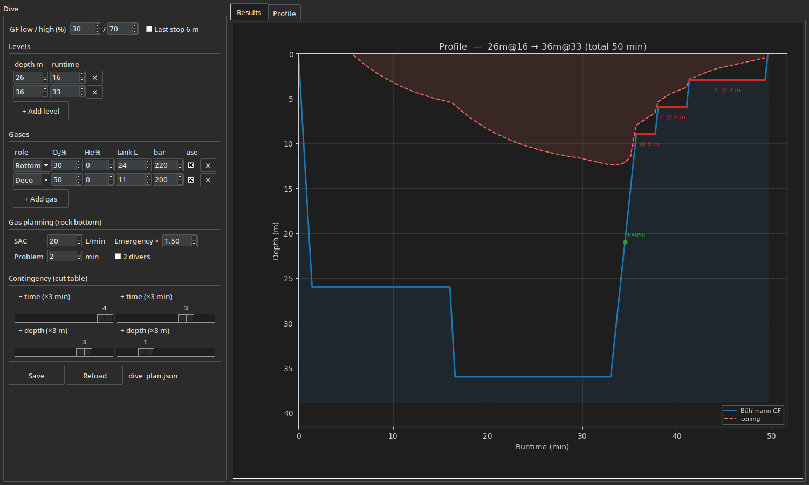

<div align="center">


# Bühlmann ZHL-16C + gradient factors + rock bottom

A small Python implementation of the Bühlmann ZHL-16C decompression model with
Erik Baker's gradient factors — a zero-dependency core, plus a CLI and a Tkinter GUI.

[](https://github.com/ekonovember/eko-deco/actions/workflows/ci.yml)


[](LICENSE)




</div>

> Dive inputs on the left; the rest of the window is tabbed — **Results** (framed
> cards + a printable wetnotes runtime) and **Profile** (the depth/time chart
> with the deco ceiling overlaid).

## What it does

- 16 tissue compartments, N₂ and He, ZHL-16C coefficients.
- Schreiner equation for variable-depth segments (descents/ascents),
  reduces to Haldane at constant depth.
- Erik Baker's gradient-factor formulation:
  `P_amb_tol = (P_comp − a·GF) / (GF/b + 1 − GF)`,
  linearly interpolated between GF-Low at the first stop and GF-High at the
  surface.
- **Multi-level planning**: a dive is a list of levels (depth + cumulative
  runtime; the planner breathes the gas relevant at that depth), not just one
  square bottom. Levels are contiguous — the transit to a level is part of its
  runtime, the same definition MultiDeco, GFDECO and Subsurface use. A level
  shallower than the ceiling is flagged rather than silently planned.
- Automatic first-stop detection, 3 m stops (last stop 3 m or 6 m), and best-gas
  selection: deco gases switch at their MOD (ppO₂ ≤ 1.6) snapped to a standard
  stop depth — O₂ at the 6 m stop, EAN50 at 21 m.
- Multi-gas support: bottom + multiple acceleration/deco gases + travel gases,
  switched automatically by ppO₂ window (MOD ceiling + hypoxia floor). Handles
  hypoxic trimixes (e.g. 10/70) that need a travel gas near the surface.
- **Safety rails on every schedule**: segments breathed outside the ppO₂ window
  (air below its MOD, a hypoxic mix with no travel gas) are flagged, never
  silently planned; gas density over 6.2 g/L
  (Anthony & Mitchell) warns too. Each plan reports **CNS%** (NOAA clock),
  **OTU**, **END** and gas density, and swapped gradient factors
  (GF-low > GF-high) are rejected as input errors.
- **Fresh water and altitude**, not just sea-level salt: pick the water type
  (`--water salt|fresh`, or a metres-per-bar constant of your own) and the site
  altitude (`--altitude 1500`, or the surface pressure directly). Both move
  every pressure the plan derives — the schedule, ppO₂, MOD, END, gas density,
  CNS/OTU and gas volumes — so a mountain lake plans as a mountain lake.
  (It assumes you are *acclimatised*: the tissues start at the site's surface
  pressure. Drove up this morning? Add margin the model doesn't.)
- Rock-bottom / minimum-gas planning: one basic SAC — plus an optional separate
  **deco SAC** for gas breathed off a stage — an emergency SAC
  multiplier (e.g. 1.5), a problem-solving time and a diver count. Rock bottom
  is the back-gas reserve to survive a problem at the worst moment and follow
  the real ascent/deco to the first gas switch (to the surface, through every
  stop, if there is none); with 2 divers the emergency assumes a buddy out of
  gas sharing your supply until that first switch — plus
  Time-To-Surface (TTS).
- Lost-deco-gas contingencies in the GUI: the schedule re-planned without each
  deco gas (and without all of them), with per-scenario gas usage showing what
  the dive **needs at the normal SAC against what you actually carry** (tank size
  × fill pressure), and the **emergency total** in parentheses — that normal
  need **plus the rock-bottom reserve held on top**: the problem-solving minutes
  at the worst moment (end of the bottom phase, at max depth) plus the real
  planned ascent + deco to the next gas switch (all the way to the surface if
  there is none) at the emergency SAC (SAC × multiplier) — bar
  remaining, and a `SHORT!` flag when a contingency outruns a cylinder at the
  normal SAC — plus a second `SHORT!` inside the parens when even need-plus-reserve
  is exceeded.
- A contingency **cut table** for a bottom-timer (gauge) backup, MultiDeco/
  V-Planner range-plan style: the dive flattened to a square profile at max
  depth, re-planned on a fixed **3 min × 3 m grid** around the plan — rows are
  bottom-time variants, columns depth variants, each cell the stop schedule as
  `depth:min` pairs plus TTS. How many steps shorter/longer and shallower/deeper
  is adjustable per direction (0 disables it) — if the computer dies you read
  max depth + dive time off the gauge and round UP to the next row/column.
- A deco-ceiling curve on the profile chart (Subsurface-style): the
  GF-interpolated ceiling, anchored on the planned first stop, drawn as a dashed
  line with a translucent curtain from the surface.
- Shared JSON config (`dive_plan.json`): the GUI and the CLI read/write the same
  dive, so `deco plan --save` shows up in the app on Reload and vice-versa.
  Levels are pure depth/time periods; gas is chosen **automatically by role**
  (bottom gas while breathable, travel gas where not, deco gases on the ascent),
  so there is one source of truth and no per-level gas overrides to reconcile.
- Printable **runtime** (wetnotes card) in the GUI — depth / stop / runtime / gas
  plus TTS and minimum-gas / turn pressure — exportable to PNG to take in the water.
- NDL calculator and tissue-loading report.

## Install

Python 3.10+. The core library and CLI need **nothing** beyond the standard
library; the GUI extra adds `matplotlib` (tkinter ships with CPython).

```bash
pip install -e ".[gui]"        # from a checkout: CLI + GUI
pip install -e .               # CLI only, zero dependencies
```

That puts two commands on your PATH — `deco` (console planner) and `deco-gui`
(the app). Both also run as modules without installing anything, straight from
a checkout:

```bash
PYTHONPATH=src python -m deco.cli plan --depth 30 --time 25 --gas air
PYTHONPATH=src python -m deco.app
```

### Where your dive lives

`dive_plan.json` is shared by the CLI and the GUI. It is looked up in this
order: `$DECO_CONFIG`, then `./dive_plan.json` if the directory you are in has
one, then your per-user config directory
(`~/.config/eko-deco/dive_plan.json`, `%APPDATA%\eko-deco\` on Windows). So a
folder per trip works, and so does running `deco` from anywhere.

## The app (GUI)

Run `deco-gui` for the visual planner shown above:

- **Left** — every input: gradient factors and a **Last stop 6 m** switch
  (Shearwater/MultiDeco style); an editable **Levels** list — add a level per
  row (depth + cumulative **runtime**) to plan a multi-level dive, with gas
  chosen automatically by role. Runtime is minutes since the surface at the
  *end* of the level, transit included, so levels simply follow one another; an
  editable gas stack (bottom / travel / deco, each with its own O₂, He, tank and
  fill, and a **use** checkbox to leave a gas out of the plan without deleting
  it); SAC, the emergency SAC multiplier, the problem time (minutes solving
  the problem at max depth before the emergency ascent) and a **2 divers**
  checkbox (a buddy shares your gas until the first switch); four **Contingency (cut table)**
  sliders — bottom-time steps −/+ and depth steps −/+ on the fixed 3 min × 3 m
  grid (0 disables a direction); plus **Save / Reload** of the shared
  `dive_plan.json`.
- **Results tab** — results as framed cards (gas, dive summary, the
  MultiDeco-style stops + lost-deco-gas scenario table, per-scenario gas usage
  (have / need per cylinder, emergency total — need + reserve — in parens), per-cylinder gas + rock
  bottom) and a printable **runtime** wetnotes card — one framed card per
  lost-gas scenario, then the **CUT TABLE** matrix card (bottom-time rows ×
  depth columns, each cell the stops + TTS; `*` marks the planned row and
  column) — exportable to PNG with the `<//> eko-deco` mark.
- **Profile tab** — the depth-vs-time chart: the Bühlmann GF ascent with stops
  and gas switches, plus the decompression ceiling (dashed, with a translucent
  curtain from the surface) so you can see how close the schedule runs to it.

**Dark mode** lives in the **Settings** menu and themes the whole app including
the chart; the choice — and the window size/position, captured when you close
the app — is remembered in a per-user `ui_settings.json` under your config
directory, kept separate from the dive itself in `dive_plan.json`.

**Taskbar icon:** the app sets its `<//>` tile as the window icon everywhere.
GNOME docks additionally need a launcher to show it — register one (per-user,
no root) with:

```bash
deco-gui --install-launcher   # Linux; then log out/in once
```

## Command line

```bash
# Recreational
deco plan --depth 30 --time 25 --gas air

# Tech with deco gases
deco plan --depth 45 --time 25 --gas 21/35 \
    --deco-gas 50 --deco-gas 100 --gf-low 0.30 --gf-high 0.70

# Multi-level: RUNTIME is cumulative (minutes since the surface, at the END of the level)
deco plan --level 45:25 --level 30:40 --level 18:55 \
    --gas 21/35 --deco-gas 50 --deco-gas 100

# Hypoxic trimix over several levels — gas is automatic by role (travel down, deco up)
deco plan --level 120:20 --level 45:40 --gas 10/70 --travel-gas 35/25 --deco-gas 50

# Last stop at 6 m instead of 3 m (Shearwater/MultiDeco style)
deco plan --depth 45 --time 25 --gas 21/35 --deco-gas 50 --last-stop 6

# Contingency cut table for a bottom-timer backup: a matrix on a 3 min × 3 m
# grid — bottom-time rows shorter/longer, depth columns shallower/deeper.
# Bare --contingency takes the step counts from the config; or pass
# TB[:TA[:DB[:DA]]] (time before/after, depth before/after; 0 disables one).
deco plan --depth 40 --time 25 --gas air --deco-gas 50 --contingency
deco plan --depth 40 --time 25 --gas air --deco-gas 50 --contingency 0:2:0:1

# Hypoxic trimix + travel gas, per-gas tanks, gas planning (TTS + rock bottom)
deco plan --depth 60 --time 25 --gas 10/70@24 \
    --travel-gas 35/25@11 --deco-gas 50@11 --deco-gas 100@7 \
    --sac 18 --sac-multiplier 1.5

# Save a dive to the shared config, then re-plan it (the GUI reads the same file)
deco plan --depth 45 --time 10 --gas air@24@232 --deco-gas 50@11@200 --sac 20 --save
deco plan dive_plan.json     # positional config (or --load)

# Fresh water at altitude, and a lower SAC on the deco cylinders
deco plan --depth 32 --time 40 --gas ean36 --deco-gas 50 --deco-gas 100 \
    --gf-low 0.40 --gf-high 0.85 --water fresh --altitude 150 \
    --sac 20 --sac-deco 16

# NDL & tissue report
deco ndl     --depth 30 --gas air
deco ndl     --depth 30 --gas air --altitude 1500     # shorter up a mountain
deco tissues --depth 40 --time 20 --gas ean32 --json
```

Gas syntax: `air`, `o2`, `ean32` / `nx32` / `32`, trimix `21/35` (fO₂/fHe %).
Each gas takes an optional cylinder suffix `mix@tank@bar` — tank size in litres
and fill pressure in bar (e.g. `air@24@232` = 24 L twinset filled to 232 bar;
`50@11` = 11 L stage at the default fill) — used for per-cylinder gas needs and
rock bottom. Add `--json` to any command for machine-readable output.

Deco-gas switches happen at standard stop depths (O₂ at the 6 m stop, EAN50
at 21 m), the way dive computers plan them, with a small ppO₂ tolerance for
the rounding.

A dive is one or more **levels**. `--depth/--time` is the square-profile
shorthand for a single level; `--level DEPTH:RUNTIME` (repeatable) plans a
multi-level dive. Gas is chosen automatically by role. **Runtime is
cumulative** — minutes since leaving the surface, at the *end* of that level,
transit included — which is how MultiDeco, Baker's GFDECO and Subsurface all
take a profile. Levels are contiguous, so there is no arrival time to set: a
runtime too short to cover the descent/ascent is rejected, exactly as MultiDeco
rejects one ("segment time … too short"). To loiter shallow before going
deeper, add a level for the shallow depth.

There are more knobs than shown above — ascent/descent/stop rates, the
shallowest-stop depth (`--last-stop`), the ppO₂
window (`--ppo2-bottom` / `--ppo2-deco` / `--ppo2-min`), the environment
(`--water`, `--msw-per-bar`, `--altitude`, `--surface-p`), the emergency SAC
multiplier, problem time and diver count for rock bottom and the emergency gas
need (`--sac-multiplier`, `--problem-time`, `--divers`) — see
`deco plan -h` (or `ndl -h`, …) for the full list. Ready-to-run
command snippets live in [`examples/`](examples/).

> **Windows note:** the source is UTF-8 (`Bühlmann`, `₂`); the default cp1252
> console renders those as mojibake — cosmetic only. Set `PYTHONUTF8=1` (or run
> `chcp 65001`) for clean output.

## Use it as a library

```python
from deco import buhlmann as b

plan = b.DivePlan(gf_low=0.30, gf_high=0.70,
                  deco_gases=(b.Gas(0.50), b.O2))
segments, tissues = b.plan_dive(45, 25, b.Gas(0.21, 0.35), plan)

print(b.time_to_surface(segments))            # TTS in minutes
print([(s.depth_start, s.duration) for s in segments if s.kind == "stop"])
print(b.ppo2_violations(segments, plan))      # never ignore these
```

The package ships `py.typed`, so type checkers see the annotations.

## Test

```bash
python -m unittest discover -s tests -t . -v
```

No install and no third-party packages needed — `tests/__init__.py` puts `src/`
on the path. The suite has two tiers:

- **174 core tests** — constant counts, surface saturation, Haldane equivalence,
  NDLs against published Bühlmann values (±5 min), multi-level profiles,
  gas-switch and travel-gas behaviour, ppO₂-violation and oxygen-toxicity
  (CNS/OTU) checks, END/density, the last-stop option, TTS / rock-bottom
  gas, the contingency cut-table matrix, the ceiling profile and config
  round-trips. Pure standard library: these run everywhere, including a bare
  Windows Python.
- **26 cross-check tests** — these compile the reference implementations
  (Subsurface's `deco.cpp` with **g++**, Baker's `GFDECO` with **gfortran**) and
  run eko-deco against them. Without those compilers the two modules skip
  themselves and you see `Ran 258 tests` — that is a *missing compiler*, not
  missing data; the skip message says so and tells you what to install. On
  Windows, install MSYS2/MinGW-w64 (or just run the suite under WSL) to get all
  284.

Every input the model takes is settable from all three front ends — the config
file, the CLI and the GUI — and `tests/test_input_coverage.py` enumerates
`DivePlan`/`GasPlan` by reflection and fails if one is not *binding*, i.e. set
through a front end and actually arriving in the plan the planner is handed.

Beyond comparing outputs, `tests/planner_diff.py` compares the *inputs*: it
keeps a registry of every model constant and planner setting, fails the suite if
one is ever added without being registered, and grades each against a reference
export as `DIVERGES`, `UNDETERMINED`, `SETTING`, `JOINT_OK` or `MATCH`. The
`UNDETERMINED` verdict is the useful one — a constant the evidence cannot speak
to must not read as agreement. `python -m tests.planner_diff` prints the report.

The oracles are compiled on demand from Python, so no `make` step is needed.
CI runs the core suite on Python 3.10–3.14 across Linux, macOS and Windows, and
has a dedicated job that installs both toolchains and **fails if the
cross-checks skip** — so "all green" can never mean "the oracles never ran".

Lint and types:

```bash
pip install -e ".[dev]"
ruff check .
mypy
```

## Validation

The planner deliberately follows the **Baker / Shearwater / MultiDeco**
gradient-factor convention: GF-Low anchored at the rounded first stop, a static
slope to GF-High at the surface, gas switches at standard stop depths. That
claim is enforced by tests, not asserted:

| Reference | How | Agreement |
|---|---|---|
| [Subsurface](https://github.com/subsurface/subsurface) `deco.cpp` | its **unmodified C++** compiled on the fly into a test oracle and driven over ctypes | tissue loading, M-value ceilings and the GF line to **machine precision**; NDLs exact at GF 100/100 |
| Erik Baker's `GFDECO` | his **original Fortran** — the published reference for the GF convention — compiled and run | ≤ **1 min** per stop, ≤ 1.3 min TTS — **square *and* multi-level** |
| MultiDeco | golden schedules, including every lost-gas column | no-loss plan matches **to the minute** |
| MultiDeco 4.24, two real exports | the plans in [`examples/`](examples/) — 8 schedules, the printed ppO₂/ead/CNS/OTU, and the gas volumes | every stop within **1 min** (3 on the 68-min all-gas-lost worst case), TTS within **1.5 min**; ppO₂ and ead reproduced **exactly**; bottom-gas litres within **1 %** at a single RMV |
| Shearwater | the worked planner example in the Perdix 2 manual (GF 30/70, its stated rates) | runtime and TTS match **exactly** |

- `tests/test_subsurface_crosscheck.py` — the Subsurface oracle (`tests/subsurface_oracle/`,
  GPL-2.0, test-only; see the README there for the license boundary). Cross-checks
  tissue loading (incl. seeded random multi-level profiles), ceilings, the GF
  interpolation line, NDL sweeps, repetitive dives, and multi-gas schedules to
  60 m at altitude and in fresh water. Needs `g++`.
- `tests/test_baker_crosscheck.py` — Baker's `GFDECO` (`tests/baker_oracle/`).
  Pins the first-stop anchor and the `--last-stop 6` behaviour. Needs `gfortran`.
- `tests/test_shearwater_golden.py` — golden schedules in
  `tests/shearwater_golden.json`, with provenance recorded per fixture.

Both oracles build themselves on first run and **skip cleanly** when the
compiler isn't installed, so the core suite stays dependency-free.

Remaining differences from Subsurface — air at 20.9 % vs 21 % O₂, salinity-based
depth conversion, a dynamic GF anchor — are **intentional**: they are exactly
what separates the Subsurface convention from the Shearwater one, and they are
listed in [`DECISIONS.md`](DECISIONS.md) #3.

## Layout

```
src/deco/          the package
  buhlmann.py      the model — tissues, Schreiner, GF ceilings, gas planning
  report.py        everything user-facing that is computed, shared by both front ends
  dive_config.py   the dive_plan.json schema: load / save / normalize
  cli.py           the `deco` console front end
  app.py           the `deco-gui` Tkinter + matplotlib app
  assets/          window/taskbar icons (packaged)
tests/             unittest suites + the two compiled reference oracles
examples/          ready-to-run command snippets
pictures/          logo, screenshots, social preview, gen_assets.py
dive_plan.json     the shared dive — agent- and hand-editable
DECISIONS.md       why the planner does what it does, numbered and cited from code
```

## Contributing

See [`CONTRIBUTING.md`](CONTRIBUTING.md) — and
[`DECISIONS.md`](DECISIONS.md) before changing model math or output. The short
version: the core stays dependency-free, warnings are load-bearing, and nothing
gets copied out of the GPL oracle.

## AI-agent friendly

The repo ships instructions and tooling for coding agents — open it in
**Claude Code** or **GitHub Copilot CLI** and the agent already knows the
project:

- `CLAUDE.md` — canonical agent instructions (module map, commands, conventions),
  also read by Copilot CLI; `AGENTS.md` points here for other tools.
- `.claude/skills/deco-buhlmann/` — an Agent Skill for dive-planning math.
- `.claude/commands/` — slash commands: `/plan-dive`, `/ndl`, `/tissues`,
  `/run-tests`.
- `.claude/agents/dive-planner.md` — a dive-planning subagent.
- `dive_plan.json` is agent-editable: ask the agent to change the dive and
  hit **Reload** in the GUI.

## License

[MIT](LICENSE).

## References

- A.A. Bühlmann, *Tauchmedizin* (5th ed., 2002) — ZHL-16 coefficients.
- E. C. Baker, *Clearing Up the Confusion About "Deep Stops"* (gradient
  factors).
- E. C. Baker, *Understanding M-values*.
- Subsurface dive-log source (constants cross-check).
